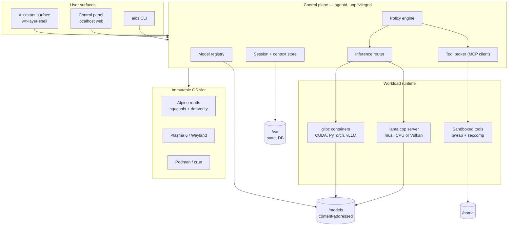

# Architecture overview

> **Status note (2026-11-10).** The layering, trust boundaries and component map
> below are current. The base is Fedora bootc (ADR-0013), so the platform layer
> details (Alpine, OpenRC, dm-verity, Plasma) are superseded: see
> [fedora-bootc.md](fedora-bootc.md). The session is COSMIC (ADR-0018), with the
> assistant as a layer-shell surface above it: not Plasma, and not a compositor
> we write.

## What this is

A bootable operating system that treats local AI as a first-class part of the
desktop rather than an application bolted on top. The OS is a curated derivative
of Alpine Linux: a pinned package set, a custom image layout, an AI control
plane, and a small set of UI surfaces.

It is **not** a new distribution. We do not fork Alpine's kernel, maintain an
independent security response, or own the package archive. We consume Alpine,
add a thin layer, and own that layer well.

## Goals

- Boot to a usable, AI-assisted desktop from NVMe in under 10 seconds.
- Inference runs locally by default. The network is optional, not required.
- The user's models and conversation history are plain files they can copy,
  back up, and move to another machine.
- OS updates are atomic and reversible. A failed update never leaves a device
  that will not boot.
- The trusted computing base stays small enough to reason about, because this
  system's headline feature is executing commands suggested by a language model.

## Non-goals (v1)

- Native CUDA on the host. See [ADR-0002](../adr/0002-nvidia-acceleration-strategy.md).
- Acting as a multi-user server or a shared inference endpoint for a network.
- Gaming parity with Proton-based distributions.
- Mobile or tablet convergence.
- Being a general-purpose distribution other people can install arbitrary
  packages onto. Package installation is a developer mode, not the product.

## Layers

| Layer | Content | Mutability |
|-------|---------|------------|
| Platform | UEFI, signed UKI, dm-verity, A/B slots | Immutable |
| OS | Alpine rootfs (squashfs), Mesa, PipeWire, NetworkManager, Podman | Immutable per slot |
| Session | Plasma 6 on Wayland, aiosd user services | Ephemeral |
| Control plane | `agentd`, model registry, session store, tool broker | Stateful, unprivileged |
| Runtime | llama.cpp server, glibc containers, sandboxed tool calls | Ephemeral |
| Data | `/models`, `/home`, `/var` | Persistent, on a separate volume |

## Component map

## Boot sequence

1. UEFI verifies the signed Unified Kernel Image (UKI) for slot A or B.
2. The kernel cmdline inside the UKI carries the dm-verity root hash.
3. dm-verity mounts the squashfs root read-only; a tampered block fails the
   mount rather than silently executing.
4. `overlayfs` presents a writable `/etc` (tmpfs upper layer, with selected
   persistent paths from `/var/etc`).
5. `/var`, `/home`, `/models` mount from the state volume.
6. OpenRC starts `aiosd` (system services), then the display manager.
7. Plasma starts; `agentd` runs as the user and binds a Unix socket.
8. A boot counter is incremented in an EFI variable and cleared once the
   session reaches a healthy state. Three uncleared boots triggers rollback to
   the other slot.

## Trust boundaries

The system's threat model is unusual: the most likely path to compromise is a
language model persuading the user, or a tool, to do something harmful. The
architecture is arranged so that "the model asked for it" never grants
capability.

| Boundary | Runs as | Can it reach the GPU? | Can it write user files? | Network |
|----------|---------|----------------------|--------------------------|---------|
| OS / init | root, immutable rootfs | yes (driver) | no, read-only root | yes |
| Desktop session | user | yes (display) | yes, own files | yes |
| `agentd` | user | no | only via tool broker | via proxy policy |
| Tool sandbox | user, namespaced | no | only bound paths | default deny |
| Model runner (CPU) | dedicated user | n/a | no | no |
| Model runner (GPU) | dedicated user | exclusive lease | no | no |
| CUDA container | dedicated user | exclusive lease | mounted paths only | default deny |

The GPU is deliberately not ambient. One process owns it at a time, via the
lease mechanism in [ai-runtime.md](ai-runtime.md#gpu-arbitration). This prevents
the common failure where a chat model and an image model fight over VRAM and
the desktop compositor loses.

## Why Alpine

Recorded in full in [ADR-0001](../adr/0001-alpine-musl-base.md). In short: small
trusted base, fast boot, apk's declarative world file, OpenRC instead of systemd,
and container tooling that is native to the distribution rather than layered on.

The cost is musl. That cost is concentrated almost entirely in GPU compute and is
the subject of [ADR-0002](../adr/0002-nvidia-acceleration-strategy.md) and
[nvidia.md](nvidia.md).
